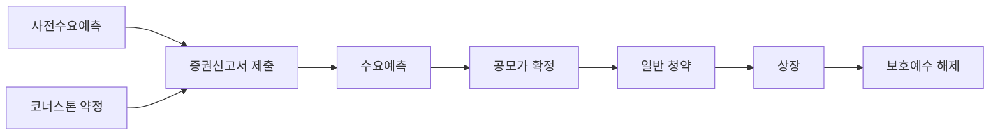

# 공모주 코너스톤투자자 제도, 무엇이 바뀌나 — 2026년 10월 시점의 기록

[2-4. 공모주 청약, 어떻게 참여하나](../part2-korea-market/2-4-ipo-subscription.md)에서 공모주가 수요예측 → 공모가 확정 → 청약 → 배정 → 상장 순서로 흘러간다고 정리했어요. **이 흐름의 앞부분에 새 단계가 하나 끼어들 예정이에요.** 「코너스톤투자자」라는 이름으로요.

**이 글도 [7-1](2026-h2-market-trends.md)·[7-2](2026-fractional-investment-sto.md)와 같은 성격이에요. 2026년 10월 6일까지 확인된 내용으로 쓴 그 시점의 기록이고, 시간이 지나면 낡아요.** 그래도 지우지 않고 그대로 남겨둘 거예요. 그러니 아래 날짜들을 꼭 함께 보세요.

그리고 이 글이 답하는 질문을 미리 좁혀둘게요. **"이제 공모주를 사도 되나"가 아니라 "코너스톤투자자가 뭐고, 제도가 지금 어디까지 왔나"예요.**

## 핵심 답변

**코너스톤투자자는 공모주 일부를 미리 배정받는 대신, 상장 뒤 일정 기간 그 주식을 팔지 않기로 묶이는 기관투자자예요.** 지금까지는 기관도 수요예측이라는 같은 절차를 거쳐 물량을 받았는데, 이 제도가 시행되면 **일부 기관은 그보다 먼저, 정해진 물량을 약속받을 수 있게 돼요.** 대가는 **최소 6개월 동안 팔 수 없다**는 거예요.

**2026년 10월 6일 기준으로 제도는 이 단계에 있어요.**

1. **법은 확정됐어요.** 이 제도를 담은 자본시장법 개정안이 **2026년 4월 23일 국회 본회의를 통과**했고 **2026년 5월 12일 공포**됐어요. **시행일은 2026년 11월 13일**이에요.
2. **세부 숫자는 아직 확정 전이에요.** 누가 참여할 수 있는지, 얼마까지 배정하는지, 몇 달을 묶는지는 시행령(법이 큰 틀을 정하고 세부를 맡긴 정부의 하위 법령)과 금융위원회 규정에 맡겨졌는데, 금융위원회가 **2026년 7월 30일 개정예고안**을 냈고 **예고 기간은 9월 8일에 끝났어요.** 이 글을 쓰는 시점까지 **최종 확정 발표는 확인하지 못했어요.**

**개인 청약자에게 가장 직접적인 사실 하나만 먼저 말하면 — 코너스톤 몫은 기관에게 가는 물량 안에서 떼어내는 구조예요.** 일반청약자 몫에서 가져가는 게 아니에요(개정예고안 기준).

미리 밝혀둘 게 하나 더 있어요. **이 글은 "그래서 공모주가 덜 떨어지게 되나"에 답하지 않아요.** 그건 제도의 목적이지, 아직 아무도 확인하지 못한 결과거든요.

## 이 글을 읽는 법

파트 7을 읽는 법은 [7-1](2026-h2-market-trends.md)의 「이 글의 숫자를 읽는 법」에 정리해 뒀어요. 줄이면 이래요 — **모든 숫자에 그 값이 정해진 날짜를 붙이고, 다음에 언제 바뀌는지 날짜로 말할 수 있는 값만 쓰고**(주가나 경쟁률처럼 그때그때 바뀌는 값은 쓰지 않아요), **확정된 것과 아직 예정인 것을 구분해서 읽어달라**는 거예요.

**이 글에서는 그 구분이 한 겹 더 있어요.** 「법」은 확정됐지만 「법이 위임한 세부 숫자」는 아직 예고안이에요. **아래에 나오는 6개월·8개월·10개월, 20%·30% 같은 숫자는 전부 예고안의 숫자**라서, 최종본에서 달라질 수 있어요.

여기서는 이 글에만 필요한 선을 하나 더 그을게요.

**제도의 목적과 제도의 결과는 다른 말이에요.**

금융위원회는 이 제도를 「**공모주 상장 후 과도한 단기매도(가격급락) 개선**」을 위해 도입한다고 밝혔어요(2026년 4월 23일 보도자료 제목). 상장 첫날 크게 올랐다가 그 뒤로 계속 내려가는 일이 반복됐고, 그 원인 중 하나로 **배정받은 기관이 상장 직후 바로 파는 것**이 지목됐다는 거예요. **이건 제도를 만든 이유예요.** 시행 뒤에 실제로 그렇게 될지는 **시행 전인 지금 누구도 확인할 수 없고, 이 글도 예상하지 않아요.**

## 코너스톤투자자가 무엇인가요

### 지금 공모주 배정은 어떻게 되나요

[2-4](../part2-korea-market/2-4-ipo-subscription.md)의 내용을 두 줄로 줄이면 이래요. **공모가는 기관투자자(자산운용사·보험사·연기금처럼 법인 자격으로 큰 자금을 굴리는 투자자)에게 얼마에 얼마나 사고 싶은지 묻는 수요예측으로 정해지고**, 공모 물량은 기관 몫과 일반청약자 몫 등으로 나뉘어 배정돼요. 일반청약자 몫은 다시 균등배정과 비례배정으로 나뉘고요.

**기관 몫이 어떻게 나뉘는지는 수요예측 결과를 보고 정해져요.** 기관이 "언제까지 안 팔겠다"고 약속하는 **의무보유확약**을 걸었는지도 배정에 반영되지만, **그건 수요예측 절차 안에서의 일**이에요. 수요예측이 끝나기 전에는 어느 기관이 얼마를 받을지 정해지지 않아요.

### 무엇이 달라지나요

코너스톤투자자 제도는 이 순서를 바꿔요. **회사와 주관 증권사가 증권신고서(공모 조건을 담아 금융감독원에 내는 공식 서류)를 내기도 전에, 자격을 갖춘 기관과 "이만큼 배정하겠다"는 약속을 미리 맺을 수 있게 돼요.**

원래 증권신고서를 내기 전에는 투자자에게 청약을 권유하거나 승낙을 받는 게 막혀 있어요. 취지로 보면, 공모 조건이 공시되기도 전에 일부 투자자에게만 먼저 정보가 가는 걸 막으려는 규제예요. **개정법은 이 금지에 예외를 두 개 만들었어요.** 하나가 코너스톤투자자이고, 다른 하나가 뒤에서 볼 **사전수요예측**이에요.

**이 그림에서 앞의 두 칸이 새로 생기는 부분이에요.** 둘 다 증권신고서 제출 전에 할 수 있게 되는 일이라 나란히 그렸고, 둘 사이의 순서는 출처에서 정해진 게 없어요. 마지막 칸인 보호예수 해제는 지금도 의무보유확약이 끝나는 날로 있지만, 코너스톤 물량은 아래에서 보듯 해제가 세 번으로 나뉘어요. 다만 **모든 공모가 이 단계를 거치는 건 아니에요.** 코너스톤투자자를 둘지 말지는 공모마다 회사와 주관 증권사가 정할 일이에요.

### 「보호예수」는 의무보유확약과 뭐가 다른가요

**보호예수**는 주식을 받은 사람이 정해진 기간 동안 그 주식을 팔 수 없도록 묶어두는 것을 말해요. 2-4에서 본 의무보유확약(락업)과 결과는 비슷해요 — 둘 다 "일정 기간 못 판다"예요. **차이는 출발점에 있어요.**

| | 지금의 의무보유확약 | 코너스톤투자자의 보호예수 |
|---|---|---|
| 언제 정해지나 | 수요예측에 참여하면서 기관이 고른다 | 증권신고서 제출 전 약정 단계에서 정해진다 |
| 필수인가 | 배정의 필수 조건은 아니다 | 걸지 않으면 코너스톤투자자가 될 수 없다 |
| 기간의 근거 | 수요예측에서 기관이 내건 확약 | **개정법이 6개월 이상**으로 정했다 |

**한 칸에 한 축만 담았어요.** 정리하면 **의무보유확약은 "고를 수 있는 약속"이고, 코너스톤투자자의 보호예수는 "자격의 조건"이에요.**

## 어디까지 왔나 — 법은 공포됐고, 세부 숫자는 아직 예고안이에요

| 단계 | 날짜 | 2026년 10월 6일 현재 상태 |
|---|---|---|
| **① 법 개정** (자본시장법) | **2026년 4월 23일** 국회 본회의 통과, **2026년 5월 12일** 공포 | **확정.** 공포 후 6개월이 지나 시행돼요 |
| **② 시행일** | **2026년 11월 13일** | **아직 시행 전이에요** |
| **③ 세부 기준** (자본시장법 시행령, 증권의 발행 및 공시 등에 관한 규정) | **2026년 7월 30일** 개정예고, 예고 기간 **9월 8일**까지 | **아직 확정 전이에요.** 금융위원회는 11월 13일 법 시행에 맞춰 개정 절차를 마무리할 계획이라고 밝혔어요. 최종 확정 발표는 이 글을 쓰는 시점까지 확인하지 못했어요 |

**표를 읽을 때 두 가지를 주의하세요.**

**첫째, ②가 지나도 그날부터 모든 공모주에 코너스톤투자자가 붙는 게 아니에요.** 제도가 「쓸 수 있게」 되는 날이지, 「써야 하는」 날이 아니에요. 첫 적용 사례가 언제 나올지는 이 글이 말하지 않아요.

**둘째, ③의 숫자는 바뀔 수 있어요.** 예고안은 의견을 듣기 위해 공개하는 초안이에요. **아래 절의 숫자를 인용할 때는 「2026년 7월 30일 개정예고안 기준」이라는 꼬리표를 함께 붙여주세요.**

### 개정예고안에 담긴 숫자

**아래는 전부 2026년 7월 30일 금융위원회 개정예고안의 내용이에요.**

**누가 될 수 있나요.** 기관투자자라고 다 되는 게 아니에요. 코너스톤투자자의 자격은 **뒤에서 볼 사전수요예측의 참여 자격에 요건을 하나 더 얹은 것**이에요. 사전수요예측 참여 자격 중 하나로, 일반 사모집합투자업자와 투자일임업자(둘 다 투자자의 돈을 맡아 굴리는 운용사예요)는 **총 위탁재산(남에게 맡아 굴리는 돈)이 300억원 이상**이어야 해요. 코너스톤투자자는 여기에 더해 **미리 약정하는 공모주 물량의 20배 이상에 해당하는 자기자본(그 기관이 가진 자기 돈)이나 위탁재산**을 갖춰야 해요. 그리고 **발행회사나 주관 증권사와 이해관계가 있는 대주주(회사를 지배하는 주주)·특수관계인(그 대주주와 가족·계열사처럼 특별한 관계로 묶인 사람과 회사) 등과는 코너스톤 약정을 맺을 수 없고**, 약정을 대가로 이익을 주고받는 것도 금지돼요.

**얼마까지 배정하나요.** 상한은 공모 물량 전체가 아니라, **일반청약자(개인 등)·우리사주조합(그 회사 직원들이 자기 회사 주식을 사려고 만든 조합)·정책펀드(하이일드펀드·코스닥벤처펀드처럼 정책상 공모주를 우선 배정받는 펀드) 몫을 뺀 나머지 기관 배정 물량을 기준으로** 정해져요. 아래 표에서 「기관 배정 물량」은 이 나머지를 말해요.

| 시장 | 코너스톤 전체 상한 | 기관 한 곳의 상한 |
|---|---|---|
| 코스피 | 기관 배정 물량의 **20%** | 기관 배정 물량의 **10%** |
| 코스닥 | 기관 배정 물량의 **30%** | 기관 배정 물량의 **20%** |

코스피와 코스닥의 차이는 [2-1. 코스피 vs 코스닥, 뭐가 다른가](../part2-korea-market/2-1-kospi-vs-kosdaq.md)에서 정리했어요. **여기서 기억할 건 이 비율의 분모가 「전체 공모 물량」이 아니라 「기관 배정 물량」이라는 점이에요.** 그래서 "공모주의 30%를 기관이 미리 가져간다"는 식의 요약은 정확하지 않아요.

**몇 달을 묶나요.** 6개월이 하한이지만, 예고안은 배정 물량을 세 묶음으로 나눠 **풀리는 시점을 나눠놨어요.**

| 배정 물량 중 비중 | 팔 수 없는 기간 |
|---|---|
| **50%** | 상장 후 **6개월** |
| **30%** | 상장 후 **8개월** |
| **20%** | 상장 후 **10개월** |

**한꺼번에 풀리지 않고 세 번에 나눠 풀리는 구조예요.** 2-4가 "의무보유확약이 풀리는 시점에 매도 물량이 한꺼번에 나올 수 있다"고 했는데, 이 구조는 그 「한꺼번에」를 세 번으로 나눠놓은 거예요. **그게 주가에 어떤 영향을 줄지는 이 글이 말하지 않아요.** 풀리는 날짜가 정해져 있다는 사실까지만이에요.

### 함께 들어오는 사전수요예측

같은 개정법에 들어간 또 하나의 예외가 **사전수요예측**이에요. 지금의 수요예측은 회사가 **희망 공모가 범위**(이 가격대 안에서 공모가를 정하겠다고 미리 밝히는 상하단)를 증권신고서에 적어 낸 **뒤에** 진행돼요. 사전수요예측은 **증권신고서를 내기 전에** 기관의 수요를 먼저 들어볼 수 있게 하는 거예요.

금융위원회가 밝힌 목적은 **희망 공모가 범위를 정하는 단계부터 시장의 의견을 반영해 공모가 산정을 더 합리적으로 하자**는 거예요. 참여할 수 있는 기관의 요건(위에서 본 총 위탁재산 300억원 이상 등)도 같은 개정예고안에 들어 있고, 일부 세부 요건은 금융투자협회 규정으로 정해질 예정이라고 보도됐어요. **시행일도 같은 2026년 11월 13일이고, 세부 기준이 아직 확정 전인 것도 같아요.**

## 개인 청약자에게 달라지는 것과 달라지지 않는 것

이 위키의 독자 대부분은 기관이 아니라 개인 청약자예요. **그래서 개인 입장에서 확인된 것만 따로 모았어요.**

**달라지지 않는 것 — 청약하는 방법.** 주관 증권사에 계좌를 만들고, 청약 기간에 증거금을 넣고, 균등배정과 비례배정으로 나눠 받고, 나머지를 환불받는 [2-4](../part2-korea-market/2-4-ipo-subscription.md)의 절차는 이 제도로 바뀌지 않아요. **이 개정은 기관 쪽 절차를 손보는 내용이에요.**

**달라지지 않는 것 — 일반청약자 몫.** 위에서 봤듯 코너스톤 상한은 **기관 배정 물량 안에서** 계산돼요. 코너스톤투자자가 붙는 공모라고 해서 일반청약자에게 돌아가는 물량을 떼어 가는 구조가 아니에요(개정예고안 기준).

**새로 생기는 것 — 확인할 정보.** 코너스톤투자자가 붙는 공모라면, **어떤 기관이 얼마를 미리 약속받았고 언제까지 못 파는지**가 청약 전에 확인해야 할 항목 하나로 늘어나요. 다만 그 정보가 증권신고서의 어디에 어떤 형식으로 실릴지는 이 글을 쓰는 시점에 1차 출처로 확인하지 못했어요. **2-4가 말한 대로 공모 조건은 증권신고서와 투자설명서에 나오니, 그 서류를 직접 열어보는 습관이 여전히 출발점이에요.**

**그리고 이 제도가 바꾸지 않는 것 — 공모가가 싸다는 보장.** 2-4의 「주의할 점」 첫째가 "**공모가가 항상 싼 건 아니에요**"였어요. 코너스톤투자자가 있다는 건 **어떤 기관이 오래 묶이는 조건을 받아들였다**는 뜻이지, **그 공모가가 적정하다는 뜻이 아니에요.** [5-6. 가치평가의 한계](../part5-analysis/5-6-limits-of-valuation.md)의 결론처럼 **어떤 지표도, 어떤 제도 정보도 그것이 지금 적정한 가격인지는 알려주지 않아요.** 기관도 틀려요.

## 이 글이 다루지 않는 것

새 제도를 소개하는 글은 "그럼 이제 공모주가 괜찮아지나"로 미끄러지기 쉬워요. 그래서 이 글이 **의도적으로 빼놓은 것 세 가지**를 밝혀둘게요.

**하나, 어떤 공모주나 기관 이름도 쓰지 않았어요.** 첫 코너스톤 사례가 어디서 나올지, 어느 기관이 참여할지는 검색하면 보도가 나올 수 있어요. 하지만 제도를 전하는 글이 특정 공모주를 언급하는 순간 그건 정보가 아니라 **"이걸 청약하라"는 신호로 읽혀요.** [6-4. 투자 심리](../part6-common-sense/6-4-investor-psychology.md)의 **FOMO**, 즉 나만 기회를 놓치고 있다는 불안이 정확히 이런 자리에서 작동해요.

**둘, 최근 공모주 성적이나 확약 비율 같은 통계를 쓰지 않았어요.** 그 숫자들은 공모가 하나 끝날 때마다 바뀌고, 트렌드 글에 들어가면 그 자체가 "지금 공모주 시장이 좋다·나쁘다"는 판단으로 읽혀요.

**셋, 효과를 예상하지 않아요.** 상장 뒤 가격 급락이 줄어들지, 공모가가 달라질지, 몇 건의 공모가 이 제도를 쓸지 이 글은 말하지 않아요. **확정된 사실과 공개된 일정, 그리고 예고안이라는 꼬리표가 붙은 숫자만 적었어요.**

## 예시로 이해하기

숫자로 확인해 볼게요. **아래 회사와 물량은 설명을 위해 지어낸 값이고, 비율은 2026년 7월 30일 개정예고안의 숫자예요.**

가상 회사 **가상로보틱스**가 **코스닥**에 상장하면서 공모를 한다고 가정할게요. **공모가는 1만원, 일반청약자·우리사주조합·정책펀드 몫을 뺀 기관 배정 물량은 100만 주**라고 해요.

**코너스톤투자자에게 줄 수 있는 최대 물량은 이래요.**

> 코너스톤 전체 상한 = 100만 주 × 30% = **30만 주**
> 기관 한 곳의 상한 = 100만 주 × 20% = **20만 주**

**한 곳이 30만 주를 다 가져갈 수는 없어요.** 상한까지 채우려면 적어도 두 곳이 필요해요. 기관 **갑**이 20만 주, 기관 **을**이 10만 주를 약정했다고 할게요.

**갑이 자격을 갖추려면 얼마가 필요할까요.**

> 갑의 배정 금액 = 20만 주 × 1만원 = **20억원**
> 필요한 자기자본 또는 위탁재산 = 20억원 × 20 = **400억원 이상**

**을은 같은 계산으로 10만 주 × 1만원 × 20 = 200억원 이상이 필요해요.** 다만 을이 일반 사모집합투자업자나 투자일임업자라면 사전수요예측 참여 자격인 **총 위탁재산 300억원 이상**도 함께 채워야 해서, **이 경우 실제 문턱은 300억원이 돼요.**

**이제 두 곳이 받은 30만 주가 언제 풀리는지 볼게요.**

> 상장 후 6개월에 풀리는 물량 = 30만 주 × 50% = **15만 주**
> 상장 후 8개월에 풀리는 물량 = 30만 주 × 30% = **9만 주**
> 상장 후 10개월에 풀리는 물량 = 30만 주 × 20% = **6만 주**
> 합계 = 15만 주 + 9만 주 + 6만 주 = **30만 주**

**상장일이 어느 해 3월 초라면 9월 초, 11월 초, 다음 해 1월 초 무렵에 차례로 풀리는 셈이에요.** 정확히 며칠부터 팔 수 있는지를 어떤 서류에서 확인하게 될지는 이 글을 쓰는 시점에 1차 출처로 확인하지 못했어요.

**그리고 이 계산 어디에도 일반청약자 몫은 등장하지 않아요.** 가상로보틱스의 일반청약자 물량이 몇 주든, 그 물량은 위 30만 주와 별개로 2-4의 균등배정·비례배정 방식대로 나뉘어요. **코너스톤 30만 주는 기관 몫 100만 주 안에서 나온 거예요.**

## 한 줄 정리

**2026년 10월 6일 기준으로 코너스톤투자자 제도는 여기까지 왔어요.** 공모주 일부를 기관에게 미리 배정하고 **최소 6개월** 팔지 못하게 하는 이 제도는, 사전수요예측과 함께 자본시장법 개정안에 담겨 **2026년 4월 23일 국회를 통과**하고 **2026년 5월 12일 공포**됐고, **2026년 11월 13일 시행 예정**이에요. 자격 요건·배정 상한(코스피는 기관 물량의 20%, 코스닥은 30%)·보호예수 구조(6·8·10개월 분할)는 **2026년 7월 30일 개정예고안**의 숫자이고, **아직 최종 확정 전이에요.**

**개인 청약자의 청약 방법과 일반청약자 몫은 이 제도로 바뀌지 않아요.** 바뀌는 건 기관 쪽 절차와, 청약 전에 확인할 정보가 하나 늘어난다는 점이에요.

**그리고 이 글이 마지막으로 남기고 싶은 문장은 이거예요. 제도의 목적과 제도의 결과는 다른 말이에요.** 왜 만들었는지까지가 이 글이 말할 수 있는 전부이고, 그걸 알고 어떻게 할지는 읽는 사람 몫이에요.

**이 글은 2026년 10월 6일까지 확인된 내용으로 쓴 기록이에요.** 위에 "예정"이나 "확정 전", "확인하지 못했다"고 적힌 항목은 **직접 확인하고 나서** 판단하세요. 그리고 시간이 지나 이 글이 낡아도 지우지 않고 그대로 둘 거예요. **시행을 한 달 남짓 앞둔 시점에 제도가 어디까지 와 있었는지가 그 자체로 기록이니까요.**

---

> 이 글은 투자 판단에 도움이 되는 일반적인 정보를 제공할 뿐, 특정 종목이나 상품의 매매를 권유하지 않아요. 제도와 세금은 바뀔 수 있으니 실제 투자 전에는 최신 내용을 다시 확인하세요.

> 함께 보면 좋은 글
> - [2-1. 코스피 vs 코스닥, 뭐가 다른가](../part2-korea-market/2-1-kospi-vs-kosdaq.md)
> - [2-4. 공모주 청약, 어떻게 참여하나 — 균등배정과 비례배정, 증거금 계산까지](../part2-korea-market/2-4-ipo-subscription.md)
> - [5-1. 재무제표, 어디서 보고 뭘 봐야 하나 (DART 사용법)](../part5-analysis/5-1-how-to-read-dart.md)
> - [5-6. 가치평가의 한계 — 지표만 보면 안 되는 이유](../part5-analysis/5-6-limits-of-valuation.md)
> - [6-4. 투자 심리 — 물타기, 손절, FOMO를 다루는 법](../part6-common-sense/6-4-investor-psychology.md)
> - [7-1. 2026년 하반기 시장 지형 — 2026년 8월 시점에서 본 것들](2026-h2-market-trends.md)
